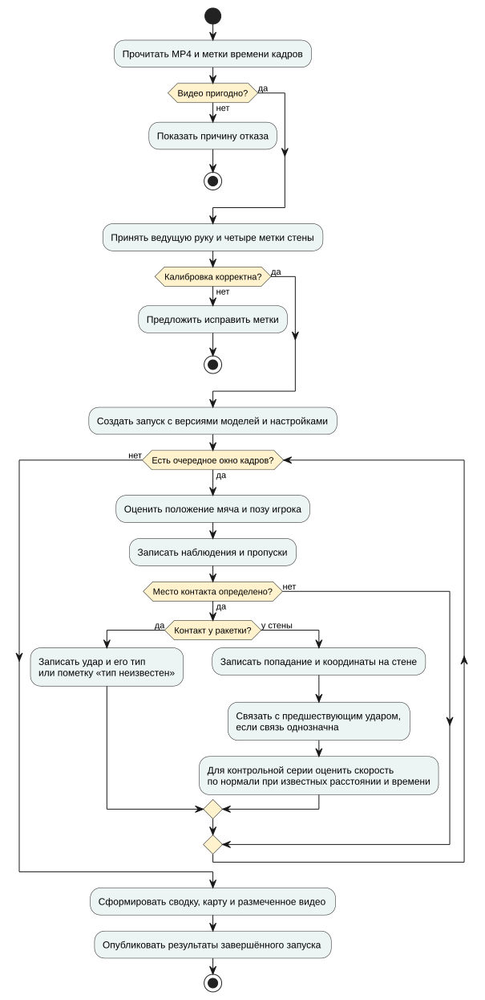
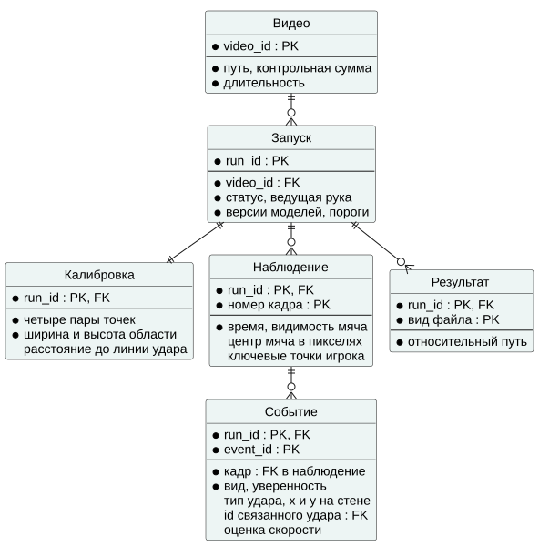
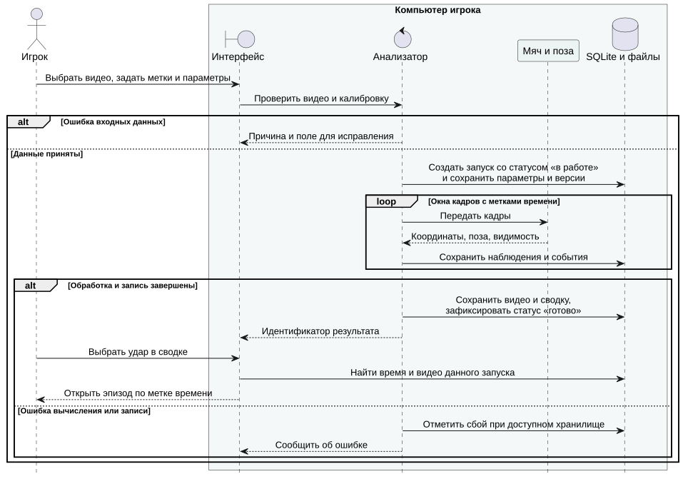
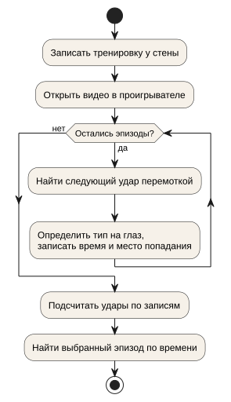
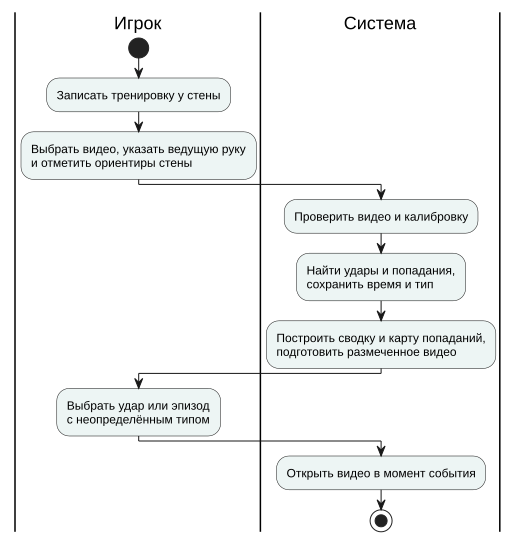

# ЛР 3 — проектирование

**Тема ВКР** — Разработка системы компьютерного зрения для анализа техники и параметров теннисных ударов у стены.

**Автор** — Усольцева Дарья Дмитриевна. Индивидуальная работа.

## 1. Предметная область и требования

### Описание предметной области

Теннисист тренируется один у стены. После серии ему важно узнать, сколько он выполнил ударов справа и слева, куда попадал мяч и в какой момент стоит пересмотреть движение. На обычной записи для этого приходится искать каждый контакт вручную. Пользователем проектируемой системы выступает сам игрок. Он снимает тренировку на смартфон, а после неё открывает файл на своём компьютере. Сценарий и состав показателей следуют из [итогов ЛР 2](https://github.com/Darrifus/tennis-cv-vkr/blob/s7-lab2/docs/research/report.md#4-итоги).

В кадре находятся один игрок, мяч и рабочая область плоской стены. Смартфон закреплён на всё время записи. Перед разбором игрок указывает ведущую руку и четыре угла прямоугольника известных размеров на стене. Удар ракеткой и последующее попадание в стену — два разных события. Тип движения относится к первому, координаты попадания — ко второму. Даже если мяч потерялся между ними, отдельно распознанный удар остаётся в статистике.

### Функциональные требования

| ID | Требование к прототипу | Как проверить выполнение |
|---|---|---|
| FR-01 | Импортировать локальное видео MP4/H.264, прочитать размеры и метки времени кадров. Сообщить причину отказа для повреждённого файла. | Открыть исправный и повреждённый файл. В первом случае сверить длительность с проигрывателем, во втором проверить сообщение и отсутствие готового результата. |
| FR-02 | Принять ведущую руку, четыре угла рабочей области в установленном порядке и её размеры в метрах. Проверить геометрию и сохранить калибровку для данного запуска. | Разметить известный прямоугольник, проверить перевод его центра в метры. Затем совместить две точки или ввести нулевую ширину — система должна предложить исправить ввод. |
| FR-03 | Построить временной ряд координат мяча и ключевых точек игрока. Отмечать кадры с пропущенными наблюдениями. | На размеченном фрагменте проверить наложение траектории и позы. При полном перекрытии мяча в соответствующих кадрах поле измеренных координат должно быть пустым. |
| FR-04 | Различать события «удар ракеткой» и «попадание в стену». Сохранять время каждого и связывать попадание с предшествующим ударом при однозначной траектории. | На эпизоде «удар — стена — удар» проверить порядок трёх событий. При разрыве траектории проверить, что сомнительная пара остаётся без связи. |
| FR-05 | Классифицировать удар как форхенд или бэкхенд по движению относительно корпуса с учётом ведущей руки. При недостатке признаков сохранять «тип неизвестен». | Сравнить с разметкой удары правши и левши. На эпизоде со скрытыми кистями и неоднозначным движением проверить отображение неизвестного типа. |
| FR-06 | Для видимого попадания вычислять координаты на плоскости стены в метрах. Для контрольной серии с отмеченной линией удара оценивать среднюю составляющую скорости по нормали к стене. | Проверить попадания в контрольные метки. При расстоянии 4 м и интервале 0,20 с ожидаемая оценка составляет 72 км/ч. При неизвестном расстоянии числовая оценка скорости должна отсутствовать. |
| FR-07 | Сформировать сводку по типам ударов, карту попаданий и размеченное видео. Из списка событий открывать видео на времени выбранного удара. | Для четырёх форхендов, трёх бэкхендов и одного удара неизвестного типа итог должен составить восемь. Число точек карты должно совпасть с числом попаданий с известными координатами. Сверить эпизод перехода с меткой события. |

### Нефункциональные требования

Пороги ниже заданы для приёмки будущего прототипа. Для проверки качества контрольные тренировки целиком отделяются от записей для обучения и настройки порогов.

| ID | Характеристика | Как проверить выполнение |
|---|---|---|
| NFR-01 | Локальная обработка. После установки моделей импорт, анализ и просмотр должны работать при отключённой сети. | Отключить сеть до запуска, обработать тестовый ролик и открыть сводку и видео. |
| NFR-02 | Прослеживаемость. Для каждого результата должны восстанавливаться исходная запись, параметры калибровки, версии моделей и пороги распознавания. | Дважды обработать одно видео с разными настройками. Из обеих сводок по идентификатору запуска восстановить соответствующие настройки и контрольную сумму видео. |
| NFR-03 | Целостность. Игроку доступны результаты только завершённых запусков. Повтор после сбоя должен сохранять результаты предыдущих успешных разборов. | Прервать запись размеченного видео, перезапустить приложение и повторить обработку. Проверить, что доступен новый полный результат, а ранее готовый разбор по-прежнему открывается. |
| NFR-04 | Качество распознавания. Целевая F1 для каждого из двух видов контакта — не ниже 0,80. Целевая доля верно определённых типов среди всех вручную размеченных ударов с известным типом — не ниже 80 %. | Сопоставить события одного вида один к одному по ближайшему времени в пределах ±0,10 с. Лишние и пропущенные события учитывать при расчёте F1. Пропущенный удар и ответ «тип неизвестен» считать ошибками классификации в указанной выборке. |
| NFR-05 | Точность локализации. Для не менее 90 % вручную отмеченных видимых попаданий расстояние от вычисленной точки до контрольной должно быть не более 0,20 м. | Использовать независимые от калибровки метки в центре и у краёв стены. Измерить евклидово расстояние в плоскости стены. Пропущенное попадание включить в знаменатель как неуспех. |

## 2. Обзор нотаций и видов диаграмм

| Нотация или вид диаграммы | Что описывает | Для чего удобна |
|---|---|---|
| BPMN | Процесс с участниками, задачами, событиями и развилками | Дорожки показывают передачу работы между участниками. |
| IDEF0 | Функцию через входы, выходы, управление и механизмы | Отделяет данные от правил и средств, которые нужны для их обработки. |
| DFD | Передачу данных между процессами, внешними участниками и хранилищами | Позволяет проследить происхождение результата и найти лишнее копирование. |
| ER-модель | Сущности, их атрибуты, ключи и кратности связей | Позволяет проверить, какие записи могут существовать отдельно и какие связи должна защищать БД. |
| UML — диаграмма вариантов использования | Цели внешних участников и доступные им сценарии | Помогает установить границы системы с точки зрения пользователя. |
| UML — диаграмма деятельности | Действия, ветвления, циклы и распределение ответственности | Подходит для сравнения ручной и автоматизированной обработки одного эпизода. |
| UML — диаграмма последовательности | Обмен сообщениями между конкретными участниками во времени | Показывает, когда сохраняются данные, возвращается ошибка и результат становится доступен. |
| UML — диаграмма состояний | Состояния одного объекта и события, вызывающие переходы | Помогает найти недопустимые переходы, например публикацию незаконченного запуска. |

## 3. Выбор нотаций для проекта

| Нотация или вид диаграммы | Что моделируем | Связанные требования | Почему подходит |
|---|---|---|---|
| UML — деятельность | Разбор серии ударов, ручной и предлагаемый сценарии | FR-01–FR-07, NFR-04, NFR-05 | Развилки отделяют контакт у игрока от попадания в стену. Дорожки показывают, какие действия игрок передаёт программе. |
| ER-модель | Локальную БД наблюдений, событий и результатов | FR-02–FR-07, NFR-02, NFR-03, NFR-05 | Ключи привязывают измерение к кадру и запуску. Необязательные поля позволяют сохранить удар при потере мяча. |
| UML — последовательность | Взаимодействие интерфейса, анализатора, моделей и хранилища | FR-01–FR-04, FR-07, NFR-01–NFR-03 | Граница компьютера показывает место обработки, а порядок сообщений определяет момент публикации результата и поведение при сбое. |

## 4. Модели системы

### 4.1. Анализ записи — UML-диаграмма деятельности

После проверки файла и геометрии стены анализатор обрабатывает перекрывающиеся окна кадров. Для мяча рассматривается модель семейства TrackNet, для положения тела — MediaPipe Pose Landmarker. Каждое наблюдение получает номер кадра и время из исходного видео. Окна уточняют траекторию, а один контакт регистрируется один раз по локальному максимуму уверенности.

**Удары и попадания (FR-03–FR-05, NFR-04).** Кандидат на удар возникает при согласованном изменении траектории мяча и движении кисти с ракеткой рядом с ним. Кандидат на попадание требует видимого приближения к стене и движения после отскока. При неоднозначном месте контакта анализатор пропускает кандидата. Если контакт ракетки различим, а тип движения определить трудно, система сохраняет удар с неизвестным типом. Следующее попадание связывается с ударом только при непрерывной траектории и отсутствии другого удара между ними.

**Координаты и скорость (FR-02, FR-06, NFR-05).** Четыре угла прямоугольника задают преобразование перспективы между кадром и плоскостью стены. Начало координат — левый нижний угол размеченной области, оси направлены вправо и вверх. Преобразование применяется в момент попадания. Для контрольной серии игрок выполняет удары у линии на известном перпендикулярном расстоянии *d* от стены. Для связанной пары событий рассчитывается *v⊥ ≈ 3,6d / (t₂ − t₁)* в км/ч. Это оценка средней скорости сближения со стеной при допущении, что мяч в момент удара находился над линией. Для обычной серии, при сомнительной связи или неположительном интервале поле остаётся пустым. В сводке показатель подписан «скорость по нормали».

**Вход и результат (FR-01, FR-07).** Ошибка видео или калибровки завершает текущую попытку до распознавания. По завершённому разбору игрок получает список событий, карту и видео. Неизвестный тип образует отдельную категорию в сводке.

### 4.2. События и измерения — ER-модель

Одна запись видео допускает несколько запусков, каждый со своей калибровкой. Каждое наблюдение принадлежит одному запуску. Событие ссылается на наблюдение по паре «запуск, кадр». На схеме PK обозначает первичный ключ, FK — внешний, звёздочка — обязательное поле. Таблицы проектируются для SQLite, а исходное и размеченное видео хранятся в файловой системе.

- **Источник измерения (FR-02–FR-04, NFR-02).** Составной ключ наблюдения исключает повтор одного кадра в запуске. Из события можно восстановить время, пиксельные координаты и использованную калибровку. Координаты мяча допускают пустое значение при потере видимости.
- **Данные удара и попадания (FR-04–FR-06, NFR-05).** Событие имеет один из двух видов. Классификация относится к удару, координаты в метрах и оценка скорости — к попаданию. Необязательная ссылка попадания на удар задаётся парой «запуск, id связанного удара». Анализатор проверяет вид события, порядок времени и единственность пары. При неизвестном значении поле остаётся пустым, поэтому попадание в точку (0, 0) сохраняет свой физический смысл.
- **Публикация (FR-07, NFR-03).** Видео и сводка хранятся в каталоге своего запуска. Анализатор записывает их во временные файлы, закрывает и переименовывает, затем одной транзакцией добавляет ссылки и переводит запуск в состояние «готово». Интерфейс выбирает только готовые запуски. После прерывания обработки оставшиеся временные файлы можно удалить при следующем старте.

### 4.3. Локальный запуск и просмотр — UML-диаграмма последовательности

Игрок передаёт путь к файлу через интерфейс. Анализатор проверяет вход, создаёт запуск и передаёт моделям окна кадров. Модели возвращают координаты и признаки видимости, а анализатор выводит события и сохраняет их. Так одно и то же время используется при классификации, построении статистики и переходе к кадру (FR-01–FR-05, FR-07).

Все программные участники и хранилище находятся в границе «Компьютер игрока» (NFR-01). Перед первым вызовом моделей уже сохранены настройки запуска (NFR-02). Ветвь сбоя завершается сообщением игроку. Если хранилище стало недоступно, запуск останется вне списка готовых. Повторная попытка получает новый идентификатор (NFR-03).

## 5. AS-IS и TO-BE

Для обеих моделей выбрана UML-диаграмма деятельности. У сценариев общие начало и результат — игрок записывает серию, подводит итог и находит удар, который хочет пересмотреть.

### AS-IS — самостоятельный разбор записи

Игрок открывает видео в проигрывателе, перемоткой находит контакт, записывает время и оценивает место попадания на глаз. Этот цикл повторяется для каждого эпизода. Чтобы пересмотреть выбранный удар, нужно снова отыскать момент по заметкам. Точность оценки места попадания зависит от ракурса, а для подсчёта ударов требуется полный просмотр серии.

### TO-BE — разбор той же записи в прототипе

Игрок один раз задаёт параметры записи. Покадровая работа переходит на дорожку системы. Анализатор строит карту и сводку, включая удары с неопределённым типом. Игрок выбирает эпизод из списка и сразу видит соответствующее движение на размеченном видео. При ошибке входных данных ему доступна причина для исправления и повторного запуска.

### Обоснование перехода

| Действие в AS-IS | Изменение в TO-BE | Как проверить эффект на одной записи |
|---|---|---|
| Искать каждый удар перемоткой и записывать время | Детектор событий формирует список с переходом к видео (FR-04, FR-07). | Измерить время от выбора заданного удара до открытия его кадра в обоих сценариях. |
| Подсчитывать форхенды и бэкхенды по заметкам | Сводка группирует события по типу, спорные удары видны отдельно (FR-05, FR-07). | Сверить итог и долю неопределённых типов с независимой ручной разметкой. |
| Определять место попадания на глаз | После калибровки события получают координаты на стене (FR-02, FR-06). | Сопоставить точки карты с физическими контрольными метками по NFR-05. |

Ожидаемый выигрыш — сокращение активного времени игрока на поиск и подсчёт. Для проверки следует отдельно измерить время действий игрока, включая ввод калибровки, и время вычислений программы. Это позволит оценить пользу и для короткой серии, где подготовка может занять значительную часть разбора.

## 6. Выводы

Диаграммы деятельности определили, где требуется решение игрока и какие действия можно автоматизировать. ER-модель выявила важное для статистики различие между ударом и попаданием. Если после форхенда мяч закрыт игроком, форхенд по-прежнему учитывается, а точка на карте и оценка скорости появятся только при достаточных наблюдениях. Диаграмма последовательности задаёт момент, с которого эти результаты доступны для просмотра.

Три модели согласованы через идентификатор запуска, кадр и метку времени. Они связывают путь от исходной записи до конкретной строки сводки и обратно к видео. Проект задаёт проверяемые критерии для последующей реализации. Точность событий и координат предстоит измерить на отдельных тренировках, а выигрыш во времени — сравнением ручного и автоматизированного разбора одной серии.
